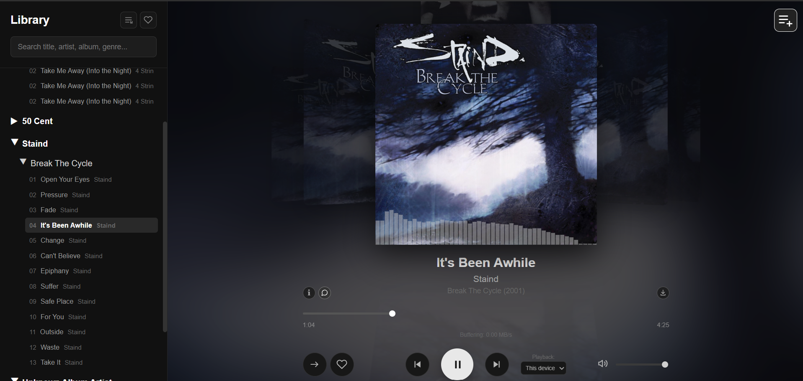
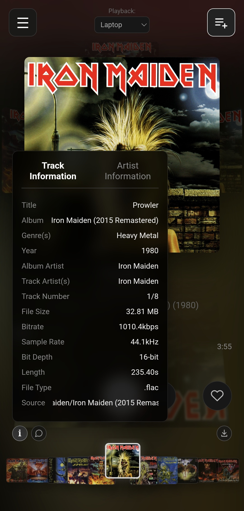
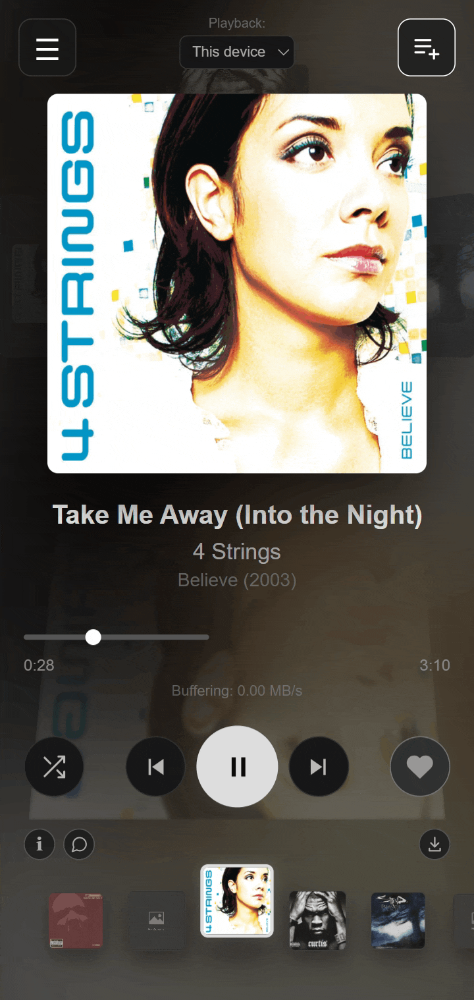
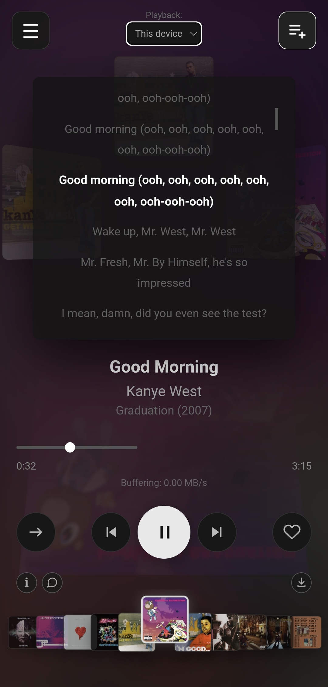
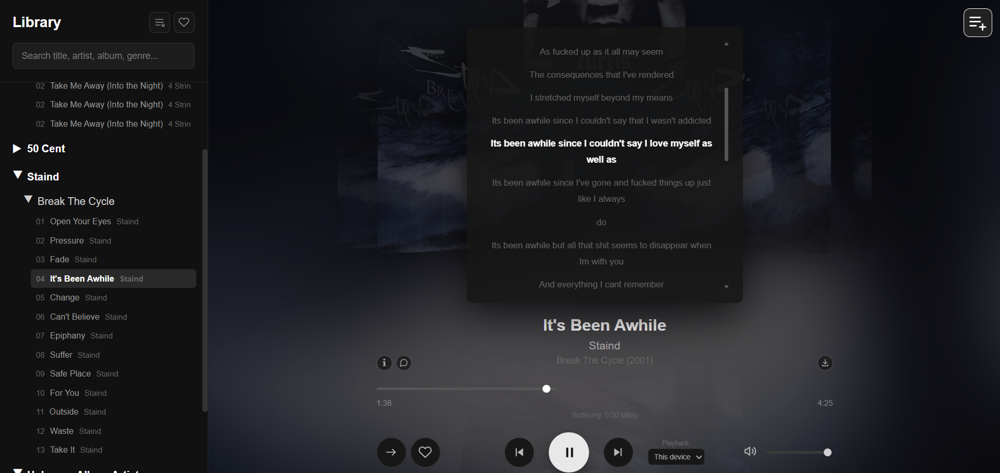

```text
███╗   ███╗██╗   ██╗███████╗██╗██████╗ ██╗██╗     ███████╗
████╗ ████║██║   ██║██╔════╝██║██╔══██╗██║██║     ██╔════╝
██╔████╔██║██║   ██║███████╗██║██████╔╝██║██║     █████╗
██║╚██╔╝██║██║   ██║╚════██║██║██╔══██╗██║██║     ██╔══╝
██║ ╚═╝ ██║╚██████╔╝███████║██║██████╔╝██║███████╗███████╗
╚═╝     ╚═╝ ╚═════╝ ╚══════╝╚═╝╚═════╝ ╚═╝╚══════╝╚══════╝
```


---
<p align="center">
<small><em>Desktop View</em></small>
</p>

---
<p align="center">




---
<p align="center"><small><em>Mobile View</em></small>
</p>

---
*Disclaimer: Album covers and artist names shown in the screenshots belong to their respective copyright owners and are displayed solely for demonstration purposes.*

## <p align="center">A self-hosted personal music library and web-based music player built for high-quality local music streaming.

Musibile is a personal music server project designed to make a large local music collection accessible through a custom web interface. It combines a lightweight web-based music player with Python-powered library management, allowing you to organize, browse, search, and play your music directly from your own computer.


Built with a focus on simplicity, customization, and self-hosting, Musibile is designed to handle a large music collection without relying on third-party streaming platforms or cloud music services.

## <span style="color: lime;">== Features ==

Custom web-based music player — A dark-themed interface with album artwork, playback controls, and a clean, responsive layout.

Music library browsing — Browse your collection by album artist, album, and individual tracks.

Search functionality — Search your library by track title, artist, album, and genre.

Album artwork — Display embedded album covers, with artwork extraction handled by the library scanner.

Playback controls — Play, pause, skip tracks, adjust volume, and seek through songs.

Shuffle and repeat — Control playback behavior with dedicated toggle options.

Animated album transitions — Cover animations and mobile swipe gestures for navigating between tracks.

Python-based metadata scanning — Extract track information such as title, artist, album artist, album, year, and genre.

Incremental library updates — Import specific album directories without rescanning the entire music collection.

Local music hosting — Serve your music library over a local network, with the possibility of remote access through a private network such as Tailscale.

Lossless audio support — Designed to work with formats such as FLAC, alongside MP3 and M4A files supported by the library scanner.

## <span style="color: lime;">== Technologies ==

HTML, CSS, and JavaScript — Frontend interface and playback logic.

Python — Music metadata scanning, artwork extraction, and album importing.

Mutagen — Reading audio metadata and embedded artwork.

JSON — Storing and exchanging music library metadata.

HTTP server — Hosting the web interface and music files.

Tailscale — Optional private-network connectivity for accessing the server remotely.

## <span style="color: lime;">== Library Management ==

Musibile includes Python scripts for scanning music directories and extracting metadata from supported audio files. The scanner collects information such as track titles, artists, albums, genres, and release years, while also extracting embedded front-cover artwork where available.

An incremental album-import workflow is intended to make library maintenance more efficient: instead of processing the entire collection every time, you can specify the album directories you want to add.

This approach is particularly useful for large libraries containing thousands of tracks.

## <span style="color: lime;">== Self-Hosting ==

The project is designed to run on your own computer, which acts as the music server. Other devices can access the web player through a browser over the same local network.

With an appropriately configured private network, such as Tailscale, the player can also be accessed remotely without making the music server publicly accessible to the entire internet.

## <span style="color: lime;">== Responsive Interface ==

The player is designed for desktop and mobile use, with a compact layout, album artwork animations, touch-based track navigation, and familiar playback controls.

## <span style="color: lime;">== Project Goals ==

Build a personal alternative to cloud-based music streaming.

Keep control of the music library and its storage.

Make large local music collections easier to browse and maintain.

Learn and apply Python, JavaScript, HTML, and CSS through a practical project.

Explore self-hosting, networking, metadata processing, and media delivery.

## <span style="color: lime;">== Project Status ==

Musibile is an ongoing personal project. Features, performance, and library-management workflows are being refined as the project develops.

## <span style="color: lime;">== Privacy and Ownership ==

Your music library remains on your own hardware. The project is intended for personal use, giving you control over your files, library organization, and access to your music.

Built as a personal project to combine music, programming, and self-hosted infrastructure.

## <span style="color: lime;">Requirements

- <span style="color: lime;">Python 3
- <span style="color: lime;">Mutagen</span>, for reading audio metadata and embedded artwork
- <span style="color: lime;">Flask</span> and <span style="color: lime;">Flask CORS</span>, for the backend
- <span style="color: lime;">Node.js</span> installed on your machine to be able to create a server over http or https
- An existing music library directory
- <span style="color: lime;">VLC</span> & <span style="color: lime;">vlc-python</span> library installed on the machine
- <span style="color: lime;">sqlite3</span> library, for playlists functionality

Install the required python dependencies from your project's virtual environment:
```bash
pip install -r requirements.txt
```
## Steps: 
## 1. Full Library Scan

Generate a new library database by scanning all supported audio files inside the specified music directory and its subdirectories.

**Command:**

```bash
python libraryscanner.py --scan "C:\Users...\YourLIbraryOfMusic"
```

Short form:

```bash
python libraryscan.py -s "C:\Users...\YourLIbraryOfMusic"
```

### What it does

1. Recursively searches the music directory and its subdirectories.
2. Identifies supported audio files: `.flac`, `.mp3`, `.m4a`, and `.opus`.
3. Reads metadata using Mutagen.
4. Extracts embedded front-cover artwork where available.
5. Creates a JSON entry for each successfully read audio file.
6. Generates a list of discovered audio-file directories.

### Metadata collected

| Field | Description |
|---|---|
| `track_number` | The sequential index number of a track within the album |
| `title` | Track title |
| `artist` | Track artist |
| `albumartist` | Album artist |
| `album` | Album name |
| `album_tracks` | Total number of tracks within the album |
| `year` | Release date or year tag |
| `genre` | Genre or comma-separated genres |
| `cover` | Relative web path to the album artwork, or `null` |
| `file` | Relative web path to the audio file |
| `size` | File size in MB |
| `bitrate` | Bitrate in kbps, if available |
| `sample_rate` | Sample rate in kHz, if available |
| `bit_depth` | Bit depth of track, in bits, if available |
| `length` | Duration in seconds |
| `file_type` | Audio file extension |
| `favorite` | A True/False flag that by default is False in the scan |

Missing metadata is generally stored as `null` or an empty string, depending on the field.

### Output files

The full scan generates two files inside the music directory:

- **`music.json`** — the complete music library database, containing metadata for all successfully read tracks.
- **`existing_songs_paths.txt`** — a sorted list of the directories containing discovered audio files.

Both files are overwritten during a full scan.

During a full scan, the terminal displays the file currently being processed:

```text
============================================================
Scanning music library at: "C:\Users...\YourLIbraryOfMusic"
============================================================

Scanning: C:\...\songs\Artist\Album\01 - Track.flac
  ✓ Cover created: Album.jpg

Scanning: C:\...\songs\Artist\Album\02 - Track.flac
  ✓ Cover already exists: Album.jpg

Scanning: C:\...\songs\Artist\Album\03 - Track.mp3
  - No embedded artwork

============================================================
Music library generated successfully!
============================================================
JSON: C:\...\songs\music.json
Existing songs paths .txt file output at: C:\...\songs\existing_songs_paths.txt
Songs found: 3
```

The example above illustrates the output format; actual messages depend on the files encountered.

## 2. Incremental Library Update

Add music from one or more specified directories without scanning the entire existing music library.

**Command:**

```bash
python libraryscan.py "C:\Users...\YourLIbraryOfMusic" --update "C:\Music\Artist A\Album 1" "C:\Music\Artist B\Album 2" "C:\Music\Artist C\Album 3" ...
```

Short form:

```bash
python libraryscan.py "C:\Users...\YourLIbraryOfMusic" -u "C:\Music\Artist A\Album 1" "C:\Music\Artist B\Album 2" "C:\Music\Artist C\Album 3" ..."
```

The argument prior to `-u` is always the root music library directory, where the source-of-truth music.json must be stored. The paths immediately following `-u` are the folders to import.

### What it does

1. Validates the supplied import directories.
2. Reports invalid directories and skips them.
3. Lists the leaf directories discovered during validation.
4. Requests confirmation before proceeding.
5. Scans supported audio files in the valid directories.
6. Extracts metadata and attempts to extract front-cover artwork.
7. Appends the new track entries to the existing `music.json`.
8. Updates `existing_songs_paths.txt`.
9. Creates a file `updates.json` in the same directory as `music.json`. This will be later used to append newly updated tracks in the music.json file, to the pre-existing `library.db`, without re-forming the entire database from scratch.

If any supplied directory is invalid, the script asks whether to continue with the valid directories or cancel the update.

During an incremental update, the script displays the directories to import, requests confirmation, and finally reports the number of song entries added:

```text
Updating music library at: "C:\Users...\YourLIbraryOfMusic"

Valid directories to add:
  C:\Music\Artist\Album

Continue with the update ? (Invalid directories will be skipped) (y/n): y

Songs added: 12
```

**Important:** The update operation appends entries without checking whether those tracks already exist in `music.json`. Importing the same directory twice can therefore create duplicate entries. Use this mode for new, not-yet-imported folders.

## 3. Check Embedded Album Artwork

Use the `--cover` option alongside `--scan` to check whether supported audio files contain embedded artwork.

**Command:**

```bash
python libraryscan.py --scan --cover "C:\Users...\YourLIbraryOfMusic"
```

Short form:

```bash
python libraryscan.py -s -c "C:\Users...\YourLIbraryOfMusic"
```

### What it does

The script recursively examines supported audio files and prints a status for each file:

- `HAS IMAGE` — the file exposes embedded picture data.
- `NO IMAGE` — no picture data was found.
- `ERROR` — an exception occurred while examining the file.

Files without embedded pictures are listed again at the end of the check.

**Note:** This option performs an artwork check, then continues with the full library scan. It is not a standalone artwork-checking mode.

## 4. Command-Line Options

| Option | Description |
|---|---|
| `-h`, `--help` | Display command-line help |
| `-s`, `--scan` | Perform a full library scan |
| `-u`, `--update` | Import one or more directories into the library |
| `-c`, `--cover` | Check embedded artwork before scanning; requires `--scan` |

The script requires exactly one operating mode: `--scan` or `--update`. The root music directory must also be supplied.

To display the available options:

```bash
python libraryscan.py --help
```
## 5. Setup New Database

Using the `setupdb.py` script to generate from scratch, a new database (sqlite3) containing all the data from `music.json`

```bash
python setupdb.py 'C:/Users/Music'
```

, where `'C:/Users/Music'` is the directory of `music.json` source-of-truth file. This database will be used to store/create/edit/delete playlists.

## 6. Update Existing Database
Using the `updatedb.py` script to update a pre-existing database of tracks by providing through command-line arguments the path of `library.db`, in which same directory an `updates.json` file must be present (after executing the `libraryscanner.py` script with its `--update` function).

```bash
python updatedb.py 'C:/Users/Music'
```
`'C:/Users/Music'`: Directory to music library where all the albums and .json files are, and where the database is stored. After successfully updating the database, the `updates.json` file is <span style="color: red;">**deleted**</span>.

## 7. Start a Server
Running the `start_server.py` script, a sequence of actions takes place. Particularly, the HTML browser-based server is launched, alongside the Favorites API, Playlists API and the VLC Playback Source API, providing a ready-to-use application.

```bash
python start_server.py './Music' --https [OR] --http
```
, where `./Music` is the directory containing the albums and tracks, alongside the `music.json` and `library.db` files.

There are two options to launch the server, over http or, using valid certificates present in the root directory of the project, over https. <span style="color: lime;">Launching the server over https provides the option for Musibile to be used as an installable PWA app on mobile!</span>

## 8. Important Usage Considerations

- Always quote Windows paths containing spaces.
- Run a full scan when you need to regenerate the entire library `music.json`.
- Use incremental updates to avoid repeatedly processing an established collection.
- Back up `music.json` before importing new music, especially while the update workflow is being developed.
- Avoid importing the same albums more than once.
- Keep the root music folder consistent with the paths expected by the web player.

### Current implementation limitations

The current code has a few behaviors worth knowing before relying on incremental updates:

1. **Duplicate prevention:** the update function does not check existing track paths before appending to `music.json`.
2. **Path-list inconsistency:** a full scan writes album directories to `existing_songs_paths.txt`, while an update adds individual file paths. The update also uses a different set of supported extensions when updating that file.
3. **Artwork paths:** the update function can construct a cover path even when no cover file exists, so the resulting JSON may reference missing artwork.
4. **Update failures:** the update operation does not catch all file-reading or artwork-writing exceptions.

These limitations should be addressed before using incremental imports as a fully reliable library-maintenance workflow.

---

Musibile's library scanner is designed to support large personal music collections by separating initial library generation from incremental imports. A full scan builds the database from the files on disk, while the update mode is intended to add selected folders to an existing library.

## HTML Music Player

Musibile includes a custom-built, browser-based music player designed to provide a clean, immersive way to browse and listen to a personal music library. Built with **HTML, CSS, and JavaScript**, the player runs directly in the browser without requiring a dedicated desktop application.

The interface features a **dark theme**, album artwork, a blurred artwork background, and a collapsible music library organized by **album artist → album → track**. Search functionality makes it easy to find songs by title, artist, album, or genre.

### Features

- **Music Library Browser** — Browse albums and tracks through a collapsible library tree.
- **Album Artwork** — Display album covers with animated transitions and surrounding artwork previews.
- **Playback Controls** — Play, pause, skip tracks, adjust volume, and monitor playback progress.
- **Playback Modes** — Switch between sequential playback, shuffle, and repeat-current-track modes.
- **Favorites - Liked Songs** - Like / Un-like a track and update it's metadata in the music.json file in real time.
- **Playlists** - Create, edit, delete playlists on the browser by storing-removing elements in/out of the `library.db` database.
- **Album Navigation** — Scroll or swipe vertically through albums, with animated cover transitions and previews of neighboring albums.
- **Track Navigation** — Move between tracks using playback controls, with horizontal album artwork previews.
- **Visual Effects** — Real-time audio spectrum visualization and a blurred album-art background.
- **Buffering Information** — Monitor playback buffering and network transfer activity.
- **Responsive Interface** — A mobile-friendly layout with touch gestures and adapted controls for smaller screens.
- **Lyrics & Artist Info Fetching** from web APIs (LRCLIB & Wiki).
<p align="center">

</p>

- **Local Music Streaming** — Stream music hosted on a personal computer over the home network, with remote access possible through a private network connection.
- **Playback Source Switching** — Toggle between playback coming out of the servers audio output (if available) or any connected devices to the local server.

## Getting Started from Scratch

**Musibile** can be set up using nothing more than a directory containing your music library. You do not need an existing `music.json` file or a preconfigured database to begin.

1. **Prepare your music library:** Place your music files in a directory, preferably organized into folders by artist and album. Musibile supports `.FLAC`, `.MP3`, and `.M4A` files. The root folder containing all sub-folders of artists, albums etc must be named **Music**. <span style="color: lime;">A typical application directory would look like this:  
```bash
.
├── icons
│   ├── musibile-192.png
│   └── musibile-512.png
├── images
│   └── no_artwork.png
├── Music
│   ├── Artist_1
│   │   └── Album_1
│   │       ├── 1-01 Track1.flac
│   │       ├── 1-02 Track2.flac
│   │       └── 2-01 Track2.mp3
│   ├── Artist_2
│   │   └── Album_1
│   │       ├── 1-02 Track1.flac
│   │       └── 2-01 Track2.mp3
│   ├── existing_songs_paths.txt (created after running `libraryscanner.py` with `-s`)
│   ├── library.db (created after running `setupdb.py`)
│   ├── music.json (created after running `libraryscanner.py` with `-s`)
│   └── updates.json (created after running `libraryscanner.py` with `-u`)
├── cert.pem (optional for running the server over https)
├── favicon.ico
├── favorites.py
├── index.html
├── key.pem (optional for running the server over https)
├── libraryscanner.py
├── manifest.webmanifest
├── musibile_receiver_api.py
├── package-lock.json
├── package.json
├── playlists_api.py
├── requirements.txt
├── setupdb.py
├── start_server.py
└── updatedb.py
```
2. **Configure and scan your library:** Set the music directory in the scanner's configuration (as in-line arguments) so it points to your collection. Run the library scanner to discover your tracks, extract their metadata and embedded artwork, and generate the initial `music.json` file. This step can be performed to UPDATE your `music.json`, after having it already created. This is to append new insertions in the `music.json` for newly added albums, without having to re-parse the whole music library!
3. **Initialize the database:** Run `setupdb.py` to create the database required by Musibile.
4. **Start the server:** Run `start_server.py` to launch the backend and make your library available to the web player.
5. **Open the player:** Navigate to the player in your browser and start browsing, searching, and playing your music.

Once the initial setup is complete, you can stream your collection, manage favorite tracks, and use the available playback features. When adding new albums later, use the library update workflow to add them without rescanning your entire collection.

**Note:** The exact commands and configuration depend on the scanner and server setup included in your installation.

<p align="center">
<span style="color: lime;">🎵 Enjoy! 🎶
</p>
